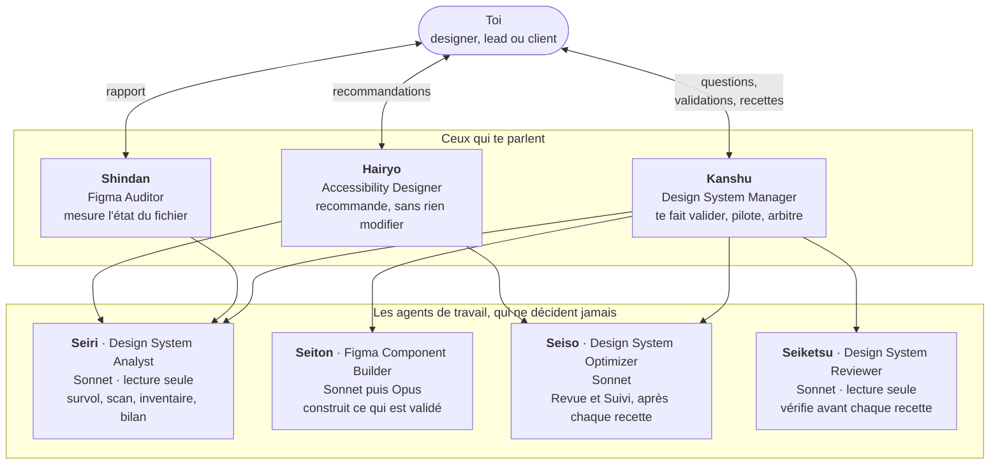
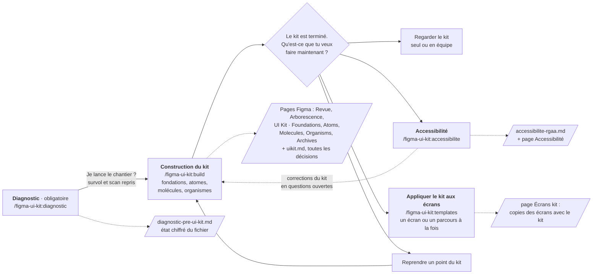
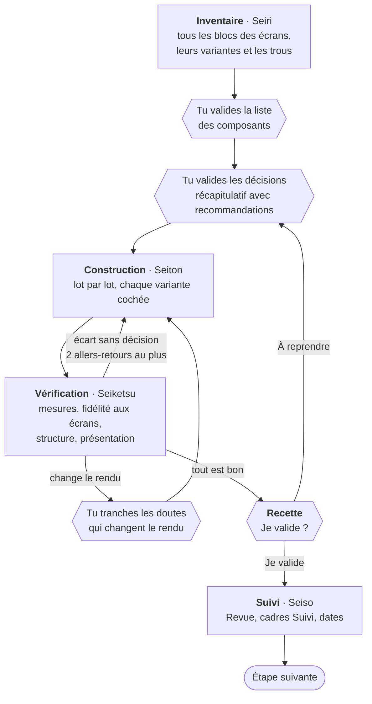

# Comment fonctionne Katiro UI Kit

Trois schémas pour comprendre le plugin : qui fait quoi, le parcours complet avec ce qu'il livre, et la boucle de chaque étape.

## 1. Qui fait quoi

Shindan, Kanshu et Hairyo sont trois rôles de la même conversation, un par commande : ce sont les seuls qui te parlent, et ils ne font rien sans ton accord. Ils partagent un seul état, `uikit.md` et le dossier `.uikit/` du chantier : ce que l'un relève sert à l'autre. Ils confient le travail à quatre agents partagés, un par compétence, qui ne décident jamais. Chaque rôle n'appelle que ceux dont il a besoin.

Les noms suivent les 5S japonais : Seiri (trier), Seiton (ranger), Seiso (nettoyer), Seiketsu (standardiser).

## 2. Le parcours complet et ce qu'il livre

Chaque étape se lance par une commande, et chacune se termine par une question : c'est toi qui décides de la suite. Le diagnostic est obligatoire : la construction refuse de commencer sans lui, puis reprend son relevé au lieu de le refaire. Il compare les écrans à un catalogue de composants de référence, selon le type de produit, et reconnaît les éléments par leur structure et leur contenu, pas par le nom des calques.

Tes écrans d'origine ne sont jamais modifiés : le kit est appliqué à des copies. Rien n'est supprimé : ce qui est remplacé part dans la page Archives.

## 3. La boucle de chaque étape

Le kit se construit par étapes : fondations, puis atomes, puis molécules, puis organismes (ou d'une seule traite, avec une seule boucle pour tout le kit). Chaque étape suit la même boucle, et tu ne vois une étape qu'une fois vérifiée.

En tête de chaque page du kit, un cadre **Suivi** montre l'état de chaque composant : `Accepted` (validé à la recette), `On hold` (bloqué par une décision), ou `Built` (construit, en attente de recette). Le détail du travail en cours reste dans `uikit.md`.

À la fin du chantier, Seiri recompte tout pour le bilan avant → après, et Seiso met la Revue à jour. En mode phase par phase, Seiketsu vérifie d'abord la cohérence entre les niveaux.
