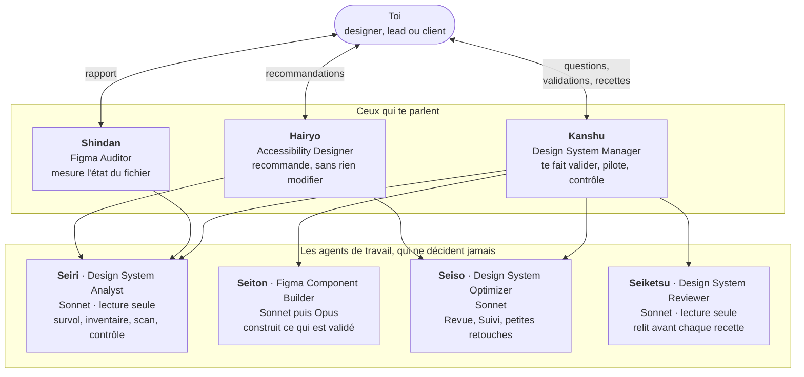
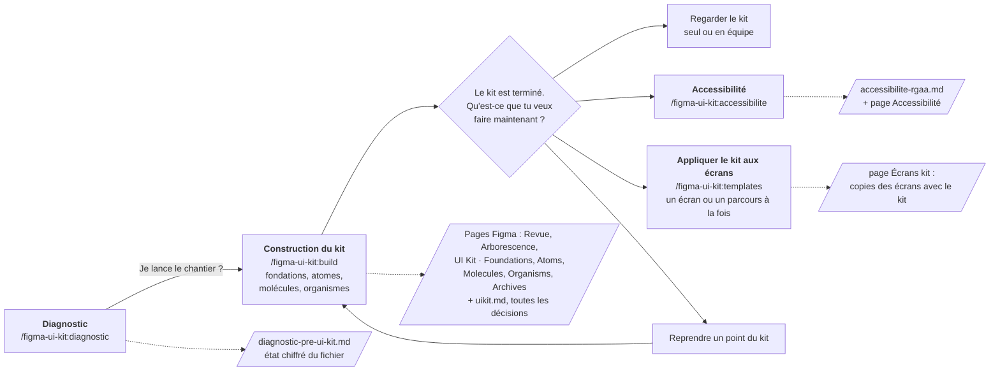
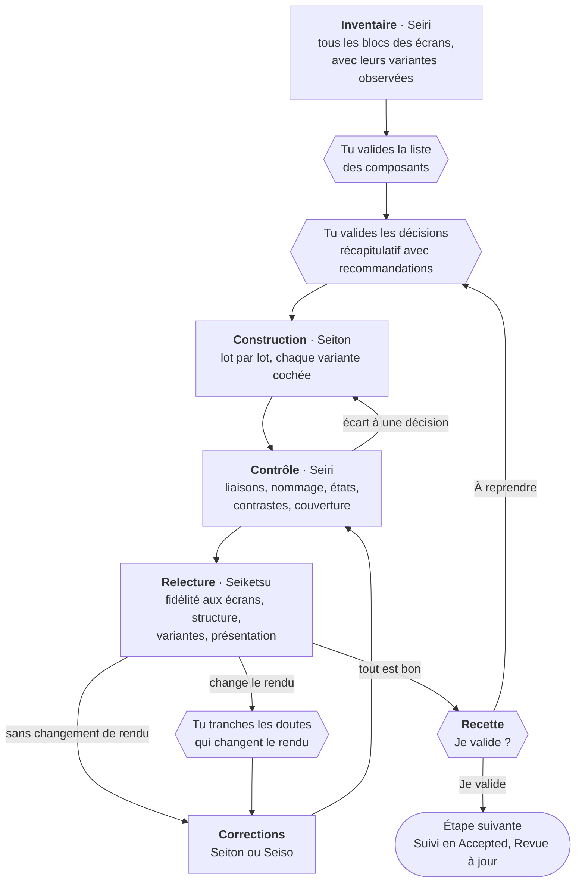
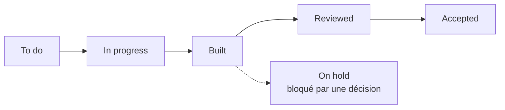

# Comment fonctionne Katiro UI Kit

Trois schémas pour comprendre le plugin : qui fait quoi, le parcours complet avec ce qu'il livre, et la boucle de chaque étape.

## 1. Qui fait quoi

Kanshu est le manager : c'est le seul agent qui te parle de la construction du kit, et il ne fait rien sans ton accord. Il confie le travail à quatre agents spécialisés, qui ne décident jamais. Shindan (diagnostic) et Hairyo (accessibilité) travaillent à part, avant et après le chantier.

Les noms suivent les 5S japonais : Seiri (trier), Seiton (ranger), Seiso (nettoyer), Seiketsu (standardiser).

## 2. Le parcours complet et ce qu'il livre

Chaque étape se lance par une commande, et chacune se termine par une question : c'est toi qui décides de la suite.

Tes écrans d'origine ne sont jamais modifiés : le kit est appliqué à des copies. Rien n'est supprimé : ce qui est remplacé part dans la page Archives.

## 3. La boucle de chaque étape

Le kit se construit par étapes : fondations, puis atomes, puis molécules, puis organismes. Chaque étape suit la même boucle, et tu ne vois une étape qu'une fois contrôlée et relue.

Pendant tout ce temps, un cadre **Suivi** en tête de chaque page du kit montre où en est chaque composant :

À la fin du chantier, Seiketsu relit tout le kit une dernière fois, Seiri recompte tout pour le bilan avant → après, et Seiso met la Revue à jour.
